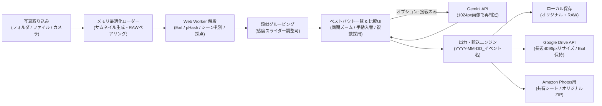
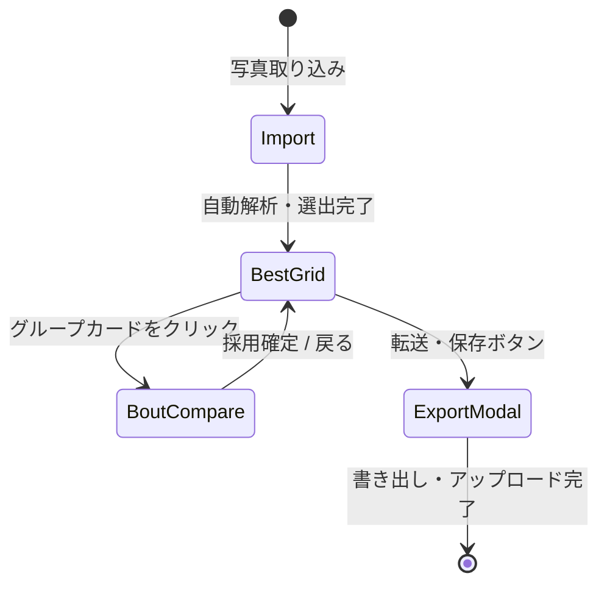

# BestBout Photo（仮称）仕様書

> **コンセプト**: 撮影した大量の写真（連写・撮り直し含む）から似た写真を自動でグループ化し、被写体（人物・風景・料理・資料など）に応じた基準で「ベストショット（ベストバウト）」を選出・比較し、イベントフォルダ単位でローカル保存や Google Drive / Amazon Photos へ送り出せる **自分専用・維持費0円のブラウザ完結型Webアプリ（PWA）**。

---

## 1. プロジェクト基本方針

| 項目 | 決定仕様 |
| :--- | :--- |
| **利用対象** | 自分専用（個人利用・一般公開なし） |
| **対応端末** | デスクトップPC / スマートフォン（レスポンシブ Webアプリ ＋ PWA） |
| **コスト方針** | **完全無料（0円）**。画像処理・AI判定・Drive転送をすべてブラウザ内で完結させ、独自サーバーを持たない |
| **UIデザイン** | **ダークモード基調**（写真の色味・ピントが見やすい濃グレー背景 `#0F1115`〜`#181B20`）。設定でライトモード切替可 |
| **想定カメラ環境** | スマホ撮影写真 〜 高画素フルサイズ機（例：Sony α1 II 50.1MP `8640×5760`・高速連写・RAW+JPEG同時撮影） |

---

## 2. 推奨技術スタック（すべて無料枠・OSS）

* **フロントエンド**: React + TypeScript + Vite
* **PWA対応**: `vite-plugin-pwa`（ホーム画面追加・オフライン起動・スマホカメラ連携）
* **UI / スタイリング**: Tailwind CSS + Lucide Icons
* **並列画像処理**: Web Worker + `OffscreenCanvas` / Canvas API
* **Exif読み書き**: `exifr`（高速パース）＋ JPEG Exifコピー処理（リサイズ時に撮影日時・カメラ情報を保持）
* **オンデバイスAI（無料・オフライン）**:
  * 顔・表情・目開き検出: **MediaPipe Face Landmarker**
  * シーン分類・類似特徴量: **Transformers.js**（軽量モデルをWebGPU/WASMで実行、初回のみブラウザキャッシュ）
* **クラウドAI（オプション）**: **Gemini API**（自分の無料枠APIキーをブラウザ設定に保存し、接戦グループのみ送信）
* **ファイル入出力 / 転送**:
  * PCローカルフォルダ直接保存: **File System Access API**（Chrome / Edge等）
  * 一括ZIP生成: `fflate`（高速・省メモリZIP生成）
  * スマホ共有: **Web Share API**（`navigator.share`）
  * Google Drive転送: **Google Identity Services (OAuth 2.0)** + **Google Drive REST API v3**（Resumable Upload）
* **ホスティング**: **Cloudflare Pages** または **GitHub Pages**（静的ホスティング無料枠・HTTPS標準対応）

---

## 3. システム構成とデータフロー

---

## 4. 機能要件（詳細仕様）

### 4.1 写真取り込み・RAWペアリング・メモリ管理

1. **取り込み手段**
   * **PC**: ドラッグ＆ドロップ、ファイル複数選択、フォルダ選択（SDカードの `DCIM` フォルダ読み込み対応）
   * **スマホ**: フォトライブラリからの複数選択、アプリ内カメラによる撮影・連続撮影モード
2. **RAW + JPEG 自動ペアリング（ON/OFF切替可・デフォルトON）**
   * 拡張子を除いたファイル名が一致するペア（例：`DSC01234.JPG` と `DSC01234.ARW`）を自動紐付けする。
   * 解析・プレビュー・比較表示は軽量な `.JPG`（または `.HEIC`）側で行い、出力時に紐付いた `.ARW` をセットで扱えるようにする。
3. **高画素機向けメモリパンク防止設計（必須要件）**
   * 50MP（`8640×5760`）画像をそのまま複数枚デコードすると1枚あたり約200MBのメモリを消費しタブがクラッシュするため、以下の3段階キャッシュとする：
     1. **解析・一覧用**: 読み込み時に長辺 `1024px` 程度のサムネイルへ縮小し、元ファイルの `File` 参照のみ保持して即解放。
     2. **比較・等倍ズーム用**: バウト比較画面で表示中の最大2〜3枚のみフル解像度デコード（閉じたら即解放）。
     3. **出力・転送用**: 出力処理時に1枚ずつ順番にストリーミング処理し、メモリピークを抑える。

---

### 4.2 類似グルーピングエンジン

* **グルーピングアルゴリズム**:
  1. Exifの `DateTimeOriginal`（なければファイル更新日時）順にソート。
  2. 画像の知覚ハッシュ（`dHash` / `pHash`）＋ 色ヒストグラム類似度（＋必要に応じてAI特徴量）を計算。
  3. **時間ボーナス**: 撮影間隔が短い連写（例：数秒〜10秒以内）は少し動きがあっても同グループになりやすいよう重み付けする。ただし見た目が大きく異なる別被写体（例：風景の直後に足元の料理）は別グループとして分離する。
* **リアルタイム感度調整**:
  * UI上の「まとめ具合スライダー（厳しめ ⇔ ゆるめ）」を動かすと、再デコードなしで保存済みの特徴量から即座に再グルーピングする。

---

### 4.3 シーン自動判別 ＆ ベスト判定ロジック

グループ内の各写真に対し、まずシーンを自動判別し、シーンに応じた重み付けでスコア（0〜100点）を算出する。

| 判別シーン | 判定トリガー（優先順） | 主な採点基準（重み付け） |
| :--- | :--- | :--- |
| **人物・ペット** | 顔検出で一定サイズ以上の顔を検出 | **顔・瞳領域のシャープネス**、目開き度（目つぶり減点）、笑顔・正面度、露出 |
| **資料・メモ** | 白地/単色背景比が高くエッジ密度が文字的 | **文字領域の局所コントラスト・シャープネス**、白飛び/影ムラの少なさ |
| **料理・モノ** | 中央被写体フォーカス＋暖色/彩度傾向 | **中央付近のピント**、適度な彩度・明るさ（暗すぎ減点） |
| **風景・建物** | 上記以外（広角・自然色・空/構造物） | **画面全体のシャープネス**、白飛び/黒つぶれの少なさ、水平の傾き |

* **僅差（接戦）フラグ**: グループ内の1位と2位のスコア差がしきい値（例：5点未満）の場合、「僅差」バッジを付与し、一覧で絞り込み・優先確認できるようにする。
* **単独写真**: 似た写真がない1枚だけの写真も、そのまま同じベスト一覧グリッドに表示し転送対象とする。

---

### 4.4 Gemini API オプション判定

* **有効条件**: 設定画面にユーザー自身の Gemini API キーが入力されている場合のみ利用可能（キーはブラウザの `localStorage` にのみ保存）。
* **呼び出しタイミング**:
  * バウト比較画面の `🤖 AIに相談` ボタン押下時
  * または一覧画面の「僅差グループを一括AI再判定」ボタン押下時（無料枠消費を抑えるため、全グループではなく接戦のみを推奨）
* **送信データ・プロンプト方針**:
  * 対象グループの候補写真（長辺 `1024px` リサイズ済みJPEG）をまとめて1リクエストで送信。
  * **Structured Output（JSON形式）** で以下を返却させ、UIに反映する：
    * `scene`: 判別されたシーン名
    * `bestIndex`: 最も優れた写真のインデックス
    * `reason`: 選定理由（例：「手前の被写体の瞳にピントが合っており、表情も最も自然です」など日本語1〜2文）
    * `runnerUpNote`: 次点との比較コメント

---

### 4.5 ベストバウト一覧 ＆ 比較・入れ替えUI

1. **ベストバウト一覧（グリッド）**
   * フィルター：`すべて` / `僅差のみ` / `シーン別` / `複数採用あり`
   * 各カード表示：サムネイル、選出枚数バッジ（例：`5枚中1位`）、シーンアイコン、`+RAW` バッジ、`僅差` バッジ
2. **バウト比較画面（PC：左右2分割 ／ スマホ：上下2分割またはスワイプ）**
   * 左（または上）に「暫定1位」、右（または下）に「対抗馬（2位以降を切替）」を配置。
   * **同期ズーム**：マウスホイール／ドラッグ・ピンチ操作で、2枚の同じ座標・倍率を連動させて拡大。ワンタッチで `Fit（全体） ⇔ 100%（等倍）` 切替。
   * **Exif ＆ スコア内訳表示**：撮影日時、焦点距離、F値、シャッター速度、ISO、および採点内訳（ピント・露出・表情等）を並列表示。
   * **操作アクション**：
     * `左を採用` / `右を採用`（ベスト入替）
     * `両方残す（複数採用）`（横位置と縦位置など、別魅力のカットを同グループから複数採用したい場合）
     * `このグループをすべて除外`（ピンボケ連写や不要カットを一括除外）
     * `🤖 Geminiに相談`（設定時のみ）
3. **PC用キーボードショートカット**
   * `←` / `→`: 対抗馬またはグループの切り替え
   * `1` / `2`: 左を採用 / 右を採用
   * `B`: 両方残す（複数採用トグル）
   * `Z` / `Space`: Fit ⇔ 100%等倍ズーム切り替え
   * `X`: グループを除外
   * `Enter`: 確定して一覧へ戻る

---

### 4.6 出力・転送機能（ローカル / Google Drive / Amazon Photos）

出力画面で **「フォルダ名」** を入力し（初期値は最頻撮影日から `YYYY-MM-DD_` を自動入力、イベント名を追記可能）、各出力先のチェックを入れて実行する。

#### 出力先別の推奨デフォルト設定（すべて切り替え可能）

| 出力先 | 推奨画質・サイズ | ファイル名 | RAW (`.ARW`) 同梱 | 出力方式 |
| :--- | :--- | :--- | :--- | :--- |
| **ローカル保存** | **オリジナル画質（無変換）** | 元ファイル名維持 | **同梱（ON）** | PC：File System Access API で直接フォルダ作成保存 スマホ等：フォルダ入りZIPダウンロード |
| **Google Drive** | **長辺 4096px / JPEG品質 88%** （約2.5〜5MB / 枚） | 元ファイル名維持 | 対象外（切替可） | OAuthログイン後、設定済み親フォルダ配下にイベントフォルダを作成し直接アップロード |
| **Amazon Photos用** | **オリジナル画質（無変換）** | 元ファイル名維持 | **同梱（ON）** | スマホ：Web Share API で共有シート呼び出し PC・共通：Amazon Photos投入用 オリジナルZIP |

* **Exif引き継ぎ ＆ プライバシー保護**:
  * リサイズ書き出し時も、元画像のExif情報（撮影日時・カメラ・レンズ情報）を出力JPEGへ引き継ぐ。
  * **GPS位置情報削除スイッチ**（ONにすると出力ファイルのGPSタグのみ除去して保存・転送）。
* **除外（ボツ）写真リスト出力（補助オプション）**:
  * PC等で元フォルダを後から整理したい場合に備え、選外となったファイル名一覧を `excluded_files.txt` としてダウンロードできるボタンを出力画面の補助メニューに用意する。

---

## 5. 非機能要件・制約事項

1. **Google OAuth の運用**: 個人利用のため、Google Cloud Console で OAuth 同意画面を「テスト（Testing）」ステータスのままにし、自分の Google アカウントをテストユーザーに登録することで、**Google の公開審査なしで無料・無制限に利用**する（スコープはアプリが作成・操作するファイルのみ扱う `https://www.googleapis.com/auth/drive.file` を推奨）。
2. **元ファイルの非破壊**: Webブラウザのセキュリティ仕様上、スマホのカメラロールや端末内元ファイルをアプリから直接削除することは行わない（常に読み取り専用で扱い、出力側を作成する）。
3. **ブラウザ対応**:
   * PC：最新 Chrome / Edge（File System Access API フル対応）、Firefox / Safari（ZIPダウンロードへ自動フォールバック）
   * スマホ：iOS Safari / Android Chrome

---

## 6. 開発ロードマップ（段階的リリース計画）

* **Phase 1（コアMVP：まずはローカル完結で使える版）**
  * 写真一括読み込み ＋ オンデバイスサムネイル生成
  * 類似グルーピング ＋ シーン別スコアリング（顔検出＋画像統計）
  * ベストバウト一覧 ＋ 2分割比較（同期ズーム・等倍・Exif表示・複数採用）
  * イベントフォルダ名指定のローカル直接保存 / ZIPダウンロード ＋ 除外リスト出力
* **Phase 2（クラウド連携・α1最適化）**
  * Google Drive OAuth連携 ＋ 親フォルダ配下への自動フォルダ作成アップロード
  * 長辺4096pxリサイズ ＋ Exif引き継ぎ ＋ GPS削除スイッチ
  * RAW (`.ARW`) 自動ペアリング機能
* **Phase 3（体験強化・PWA・AIオプション）**
  * PWA化（スマホホーム画面追加・アプリ内カメラ連写取り込み）
  * Web Share API による Amazon Photos 向けスマホ共有連携
  * Gemini API キー設定による接戦グループAI判定オプション
  * PCキーボードショートカット実装
